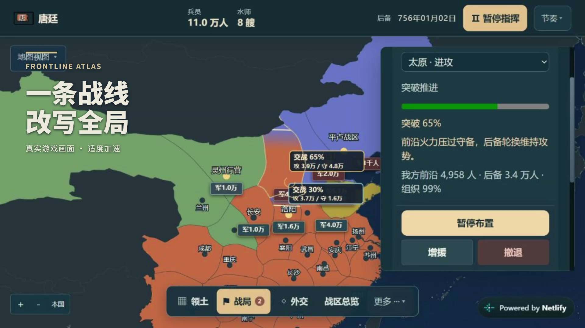

# Frontline Atlas｜钢铁雄心 · 浏览器版

一款以**地图和战争指挥为中心**的中文历史战略游戏。选择国家或军政势力，组织进攻、调动与增援，争取盟友，并在不断变化的战局中管理有限兵源和军备。战斗按日推进，不是点击后立即结算；后勤可以自动安排，复杂管理按需展开。

**[在线试玩](https://gangtiexiongxin-game.netlify.app/)** · [GitHub 仓库](https://github.com/lihao123456521/frontline-atlas) · [v58 地图与占领](docs/2026-10-24-smooth-capture-v58.md) · [v57 中国历史战场说明](docs/2026-10-21-historical-theaters-v57.md)

本项目为独立浏览器游戏，玩法灵感来自《Hearts of Iron》，不是 Paradox Interactive 的官方产品。

## 30 秒演示

[](https://github.com/lihao123456521/frontline-atlas/releases/download/v57-demo/frontline-atlas-demo-v57.mp4)

**[▶ 观看／下载 MP4](https://github.com/lihao123456521/frontline-atlas/releases/download/v57-demo/frontline-atlas-demo-v57.mp4)** · [Release 页面](https://github.com/lihao123456521/frontline-atlas/releases/tag/v57-demo)

30 秒 · 1080p · 静音中文字幕。来自正式版实际运行画面，部分片段加速，字幕为后期叠加；展示战线推进、四个剧本、军备配比、调兵与同盟。完整视频作为 Release 附件分发，避免增加源码克隆体积；[制作与来源说明](docs/demo-video.md)。

## 战役剧本

| 剧本 | 可选对象 | 战场特点 |
| --- | --- | --- |
| 1914 · 第一次世界大战 | 剧本中实际存续的国家 | 步兵、早期航空与海军；开放外交和世界战局 |
| 1936 · 第二次世界大战 | 剧本中实际存续的国家 | 从战前开始，步兵、坦克、飞机与舰队协同 |
| 1853 · 太平天国 | 清廷、湘军、太平天国、捻军 | 33 个控制区，步军、骑兵、炮队与水师 |
| 755 · 安史之乱 | 唐廷、朔方军、河北义军、安史叛军 | 33 个控制区，步军、骑兵、弓弩与水师 |

中国主题中的地方势力是独立指挥的军政阵营，不代表当时存在相应的独立主权国家。双方按同盟集团平衡现役、有限后备和补给，盟友可共同取胜，不必为了胜利吞并所有友军。

## 核心玩法

- **地图指挥**：点选省区下达出征、调动、增援或训练命令；陆军沿真实接壤路线行军，可通过本国及直接盟友的连续领土。跨海行动需要合适的港口、航线与舰队。
- **持续战斗**：区分在途部队、交战前沿与后备；组织度、补给、地形和兵种影响实际推进及损耗。占领随突破逐步完成，战报区分人员与装备损失。
- **合成作战**：现代剧本分别配置兵员、坦克、飞机与舰艇；历史主题使用对应时代的兵种和科研，不混入现代军备。
- **战术选择**：谨慎、均衡、强攻具有不同推进、伤亡风险和组织消耗，可在战中调整，也能请求盟友进攻、增援或撤退。
- **外交与内乱**：结盟、吞并、归附及战时劝降可以免费提案，对方按实力、民意与局势回应；扶持反对派、占领抵抗和地方起义会产生实际战场变化。
- **有限动员**：全省自动征兵和军备后勤保留手动入口，消耗真实兵源、库存与产能，不凭空生成无限军队。
- **动态世界**：AI 同时进行外交、生产和战争，事件随实际局势发展，不强制复刻固定历史战果。
- **自动保存**：保留部队、领土、在途命令与战局；存档位于当前浏览器和站点，换设备、域名或端口不会自动同步。

## 快速开始

需要 Git 与 Python 3；本地游玩不需要安装前端框架或运行构建工具。

```bash
git clone https://github.com/lihao123456521/frontline-atlas.git
cd frontline-atlas
python server.py
```

打开 [http://127.0.0.1:8642/](http://127.0.0.1:8642/)。服务器只使用 Python 标准库，并提供并发请求和开发环境禁用缓存响应头。也可以使用其他静态服务器托管项目根目录；建议通过 HTTP 访问，而非直接双击 HTML 文件。

如默认端口被占用，可修改 `PORT` 后启动，例如 PowerShell：

```powershell
$env:PORT = "8080"
python server.py
```

## 第一场战役

1. 选择剧本与国家／势力，可直接指挥或进入可选实操教程。
2. 点选我方省区或敌方目标，检查出发地、派出兵力和留守；确认战术后出征。
3. 观察行军与突破进度，按需要调整战术、补充援军或呼吁盟友支援。
4. 用顶栏暂停／继续；默认 4 秒推进一天，节奏菜单可改为 6 秒或 2 秒。
5. 通过“更多”打开训练、研究、后勤、记录和保存等功能，地图保持主要视野。

快捷键：`Space` 暂停／继续，`Esc` 取消命令或关闭面板。输入控件和模态窗口获得焦点时，不触发背景快捷键。触屏支持点选、单指拖动与双指缩放；响应式适配不等同于所有平板设备均已完成实机验证。

## 开发与测试

使用原生 HTML、CSS、JavaScript 和 SVG；模拟在浏览器运行，Python 只负责本地静态服务，Node.js 用于测试、构建及地图数据工具。

安装 Node.js（需支持内置测试运行器）后：

```bash
npm ci
node --test tests/*.test.cjs
python -B -m unittest discover -s tests -p test_server.py
git diff --check
```

测试涵盖地图命中与接壤、行军与战斗、兵力及资源守恒、外交内乱、时代隔离、存档和开发服务器。真实鼠标／触屏操作、横竖屏布局及生产站点资源仍需单独在浏览器验收；单元测试不替代这些检查。

### 构建与部署

```bash
npm run build
```

构建生成 `dist/`，为 JS／CSS 添加内容指纹，并生成含版本、build 和提交号的 `version.json`。将 **`dist/` 的内容**发布到你自己的静态托管站点即可；不要上传 `.git`、凭据、依赖、测试日志或本地存档。

`netlify.toml` 已配置构建命令与发布目录。在自己的 Netlify 项目中连接本仓库，也可使用其他静态托管服务；应保留 `_headers` 中适用的缓存配置，并核对页面 `hoi-build` 与 `version.json` 一致。

> **原站维护者专用发布流程**：`npm run deploy` 指向现有正式 Netlify 站点，需要该站点的登录权限；它不是通用的个人站点部署命令。本地启用 `git config core.hooksPath .githooks` 后，提交会自动执行完整测试、构建、生产发布与版本校验。普通克隆和贡献者无需启用此 Hook；不要把 Netlify 凭据提交进仓库。维护者遇到发布失败，应修复后用 `npm run deploy` 重试，不能仅凭提交成功认定已上线。

## 目录结构

```text
index.html       页面入口与脚本加载顺序
css/             地图、首页和指挥界面样式
js/              游戏引擎、地图、UI、剧本与数据资产
tests/           Node.js 与 Python 回归测试
scripts/         静态构建、发布和地图数据生成工具
docs/            设计说明、版本记录与地图来源
server.py        本地并发静态服务器
.githooks/       原站维护者的提交后发布 Hook
```

`dist/` 和 `node_modules/` 为可重建目录，不纳入版本管理。

## 历史与地图边界

- 这是可自由推演的游戏，不是精确历史模拟。国家兵力、装备、补给和训练节奏包含明确的可玩性调整，不作为历史统计引用。
- 现代政治底图基于 CShapes 数据，物理岸线使用 Natural Earth；游戏控制区、合并省份与部分年代边界存在战略近似，不代表逐日真实行政区或占领线。
- 太平天国与安史之乱借用现有中国轮廓组织独立战区，不声称复原当年精确疆界。历史背景与游戏配置的区分见 [v57 说明](docs/2026-10-21-historical-theaters-v57.md)。
- 数据来源、署名和生成方法见[历史地图说明](docs/historical-map-sources.md)与[全球地图说明](docs/world-map-sources.md)。

## 许可

**代码**采用 [MIT License](LICENSE)。

**地图资产不是全部 MIT**：CShapes 派生政治地图按 **CC BY-NC-SA 4.0** 许可分发，要求署名、非商业使用与相同方式共享；其他地图来源以对应文档声明为准。请同时遵守各类资产的许可，不要将整个项目描述为可无条件商用的 MIT 资产包。
