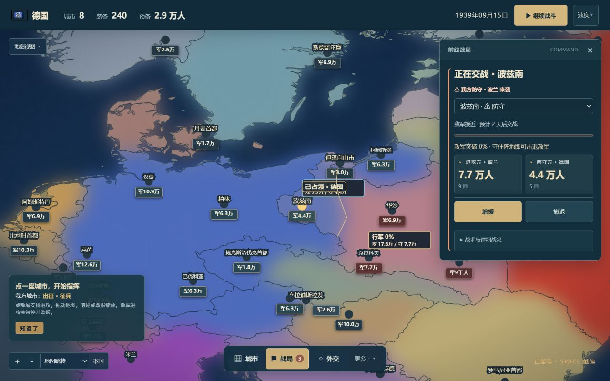

# v44 战争体验与地理规则

## 完成的行为

- 城市分区的长边使用幅度受城市锚点约束的曲线。相邻分区反向复用同一组曲线采样；着色、高亮和点击命中使用同一几何。保留真实国界及海岸。
- 新战役默认自动征兵，按资源储备和开局陆军规模扩军；月度补员保留下一支部队所需人力。玩家可调整保守、均衡、积极三种强度和已解锁陆军兵种，也可关闭自动或手动追加训练。征兵独立于贸易、研究自动后勤。
- 保留各剧本的编制总量，优先部署真实接敌前线、首都预备队和可用舰队港口。1939 德国 103 师中，对波前线 62 师、西部边境 14 师；1941 对苏前线 102 师。全部 75 个可选国家保留可用驻军。
- 开局页面收敛为国家快捷选择、完整国家列表、剧本与难度；军力预览随真实剧本同步。桌面和平板采用两栏，窄屏单栏。
- 陆路使用历史国家形状内的真实城市分区接壤。不能跳过第三国、隔海直连或从非邻接城市直接攻城；跨海沿用港口和舰队条件，飞机转场遵守航程。路线距离影响行军准备时间。
- 旧档重建地理图；无效的旧陆路攻势安全撤回并解锁守军，保留人员、组织度与单位 ID。合法进行中的战斗继续。
- 真实 AI 前线在有限劣势时可以谨慎出征；同一路线失利后恢复至少 14 天，并检查组织度。敌军进攻仍生成持久暂停警报。

## 验证

- JavaScript 全量 260 项通过，0 失败、0 跳过；Python 服务端 2 项通过。语法及 `git diff --check` 通过。
- 独立审查地图共享曲边、全部城市点击、开局同步及征兵交互，无阻断问题；32 项对应回归通过。
- 无修改状态的真实 1939 战役验证波兰与法国合法攻势；同一路线失败后的冷却、增援单位守恒有回归覆盖。
- 浏览器真实 1936 德国开局推进到 2 月 1 日，默认自动征兵生成 2 支步兵训练队列，已支付人力和装备；自动选项保持启用。
- 浏览器继续真实 1939 存档：波兹南被波兰反攻时暂停并显示防御警报，“查看战场”可打开我方防守战局。
- 浏览器点击巴黎：显示“暂无可到达的部队”，不提供跨省直达的出征命令。
- 1280×800 桌面、1024×768 平板横屏、768×1024 平板竖屏、390×844 窄屏验证；无水平溢出。征兵原生选择框高 44 px，中心实际命中控件。
- 实体 iPad/Safari 未在本次环境中测试；Pointer Events 的点击、跨日按压、拖动取消与双指缩放由现有回归覆盖。

## 界面证据

## 发布

原网址：<https://gangtiexiongxin-game.netlify.app/>。

完整本地提交后，现有 post-commit hook 再运行测试、构建带内容指纹的资源并发布固定 Netlify 站点；只有正式 `version.json`、主页 `hoi-build` 与提交一致、主页 `must-revalidate` 生效才算发布成功。本次不推送 GitCode。
